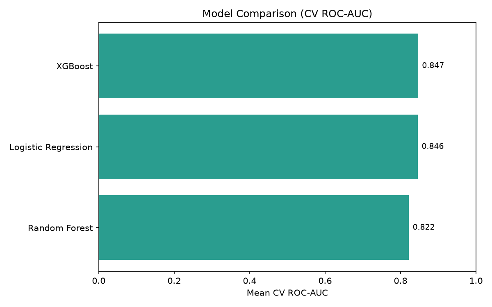
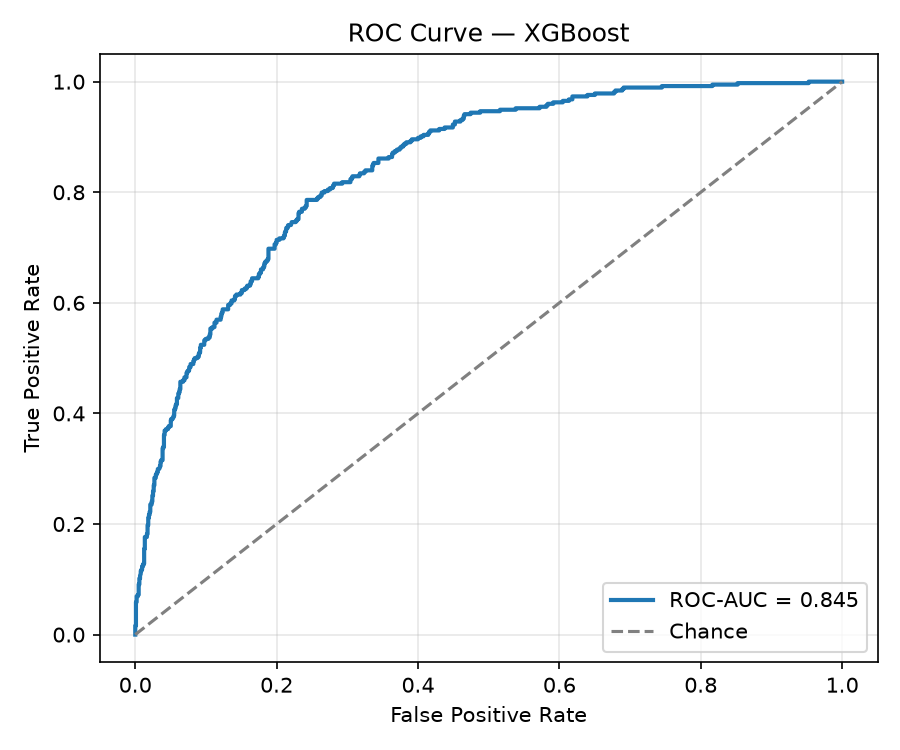
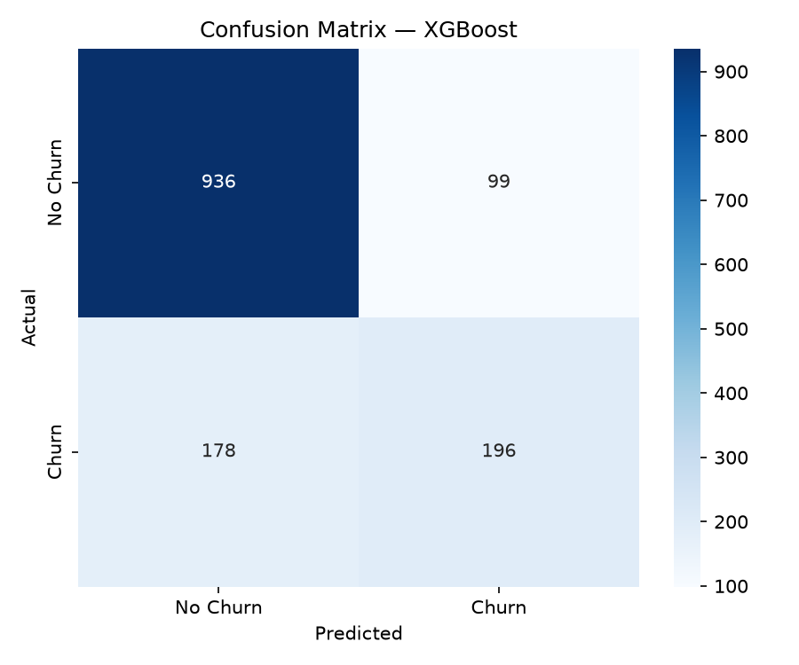
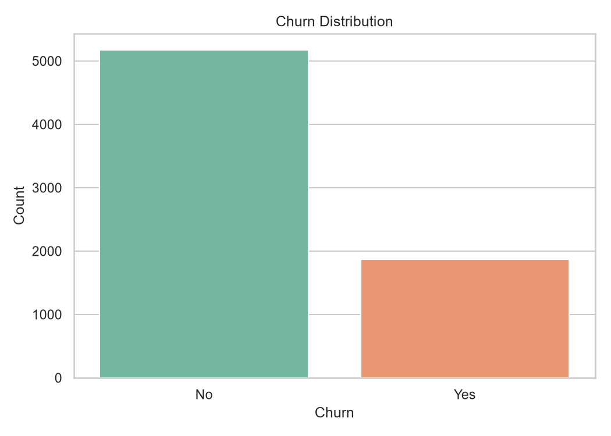
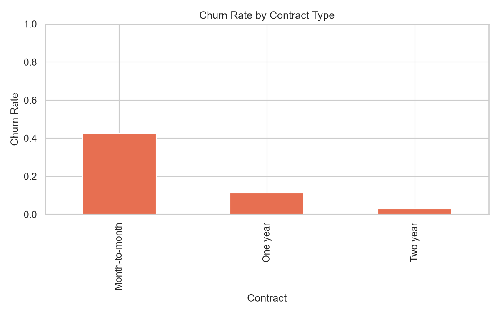

# Customer Churn Prediction System

A complete, portfolio-ready machine learning system that predicts whether a telecom customer is likely to discontinue service. The project covers exploratory data analysis, reproducible preprocessing, model comparison (Logistic Regression, Random Forest, XGBoost), evaluation, feature importance, SHAP explainability, Excel reporting, a local Streamlit dashboard, and local prediction—no REST API required.

---

## Project Overview

Customer churn is a core retention problem for subscription businesses. This system analyzes historical customer attributes from the IBM Telco Customer Churn dataset and returns:

- **Prediction:** `Churn` / `No Churn`
- **Churn probability:** positive-class probability from the trained classifier
- **Risk level:** illustrative Low / Medium / High band based on probability thresholds

Everything runs locally: train models, inspect reports, and call the prediction module from Python or the command line.

---

## Business Problem

Acquiring a new customer typically costs more than retaining an existing one. Telecom providers need an early-warning signal for customers at risk of leaving so retention teams can intervene with targeted offers, support outreach, or plan changes.

This project answers:

> Given a customer's contract, services, tenure, and billing profile, how likely are they to churn?

---

## Key Features

- End-to-end binary classification pipeline with leakage-safe preprocessing
- Stratified train/test split and 5-fold stratified cross-validation
- Comparison of Logistic Regression, Random Forest, and XGBoost
- Model selection by validation **ROC-AUC** (not test-set cherry-picking)
- Serialized scikit-learn `Pipeline` (preprocessing + model) via Joblib
- Model evaluation metrics + confusion matrix exports
- Feature importance and SHAP explainability charts
- Excel workbook (`reports/model_results.xlsx`) written after every training run
- Local Streamlit dashboard (`app.py`)
- Local prediction helper (`src/predict.py`) with risk banding
- Automated Pytest coverage for preprocessing and prediction
- EDA notebook with professional visualizations saved under `reports/figures/`

---

## Technology Stack

| Area | Tools |
|---|---|
| Language | Python 3.11+ |
| Data | Pandas, NumPy |
| ML | Scikit-learn, XGBoost |
| Visualization | Matplotlib, Seaborn |
| Serialization | Joblib |
| Explainability | SHAP |
| Dashboard | Streamlit |
| Excel export | openpyxl |
| Testing | Pytest |

---

## Dataset Description

**Dataset:** IBM Telco Customer Churn (Kaggle: *Telco Customer Churn* — blastchar)

**Expected file:**

```text
data/raw/WA_Fn-UseC_-Telco-Customer-Churn.csv
```

| Item | Detail |
|---|---|
| Target | `Churn` (`Yes` → 1, `No` → 0) |
| Rows | ~7,043 customers |
| Dropped from features | `customerID` |
| Numerical features | `tenure`, `MonthlyCharges`, `TotalCharges` |
| Categorical features | Contract, InternetService, PaymentMethod, TechSupport, and related service columns |

### If the dataset is missing

The project does **not** auto-download data from unofficial sources.

1. Download the dataset from Kaggle (blastchar / Telco Customer Churn).
2. Place the CSV at `data/raw/WA_Fn-UseC_-Telco-Customer-Churn.csv`.
3. Re-run training:

```bash
python -m src.train
```

A clear `FileNotFoundError` is raised if the file is absent.

---

## Project Architecture

```text
Raw CSV
  → clean + validate (src/preprocessing.py)
  → stratified train/test split
  → Pipeline(preprocessor + classifier) with StratifiedKFold CV
  → select best model by CV ROC-AUC
  → fit on full training set
  → evaluate on held-out test set
  → serialize Pipeline → models/churn_model.joblib
  → feature importance + SHAP + Excel report
  → local prediction / Streamlit dashboard
```

All transformations that learn from data (imputation, scaling, encoding) are fitted only inside training folds / the training set.

---

## Installation Instructions

### 1. Clone the repository

```bash
git clone <your-repo-url>
cd Customer-Churn-Prediction
```

### 2. Create a virtual environment (recommended)

```bash
python -m venv .venv

# Windows
.venv\Scripts\activate

# Linux / macOS
source .venv/bin/activate
```

### 3. Install dependencies

```bash
pip install -r requirements.txt
```

### 4. Add the dataset

Place `WA_Fn-UseC_-Telco-Customer-Churn.csv` in `data/raw/`.

---

## Model Training

Train and compare models, evaluate the winner, and save the pipeline:

```bash
python -m src.train
```

Optional: regenerate EDA figures without opening Jupyter:

```bash
python -m notebooks.generate_eda_figures
```

Open the exploratory notebook:

```bash
jupyter notebook notebooks/EDA.ipynb
```

**Outputs**

| Artifact | Path |
|---|---|
| Best model pipeline | `models/churn_model.joblib` |
| Excel results (all metrics) | `reports/model_results.xlsx` |
| CV comparison | `reports/cv_comparison.json` |
| Full evaluation report | `reports/evaluation_report.json` |
| Charts | `reports/figures/` |

Excel sheets created after training:

- `Model_Evaluation`
- `CV_Comparison`
- `Test_Comparison`
- `Confusion_Matrix`
- `Feature_Importance`
- `SHAP_Explainability`
- `Notes`

---

## Model Evaluation

### Cross-validation (model selection)

Selection metric: mean **ROC-AUC** from `StratifiedKFold(n_splits=5, shuffle=True, random_state=42)` on the training set only.

| Model | Accuracy | Precision | Recall | F1 | ROC-AUC |
|---|---|---|---|---|---|
| XGBoost | 0.8030 | 0.6624 | 0.5264 | 0.5863 | **0.8469** |
| Logistic Regression | 0.7488 | 0.5174 | 0.8013 | 0.6286 | 0.8460 |
| Random Forest | 0.7765 | 0.5694 | 0.6455 | 0.6050 | 0.8222 |

**Selected model:** XGBoost (highest CV ROC-AUC).

### Held-out test performance (selected model)

| Metric | Score |
|---|---|
| Accuracy | 0.8034 |
| Precision | 0.6644 |
| Recall | 0.5241 |
| F1 | 0.5859 |
| ROC-AUC | 0.8448 |

Metrics above were produced by running `python -m src.train` on this machine. Re-run training to regenerate them; do not treat them as production SLAs.

### Error analysis

- **False positive:** predict Churn when the customer stays → unnecessary retention cost.
- **False negative:** predict No Churn when the customer leaves → missed intervention and revenue risk.

Depending on business cost asymmetry, operating thresholds (and risk bands) can be tuned after model selection.

### Evaluation charts







---

## Streamlit Dashboard

Launch the local dashboard (from the project root):

```bash
streamlit run app.py
```

Dashboard pages:

1. Overview (best model + metrics + Excel download)
2. Model Evaluation
3. Confusion Matrix
4. Feature Importance
5. SHAP Explainability
6. Predict (single customer)

## Local Prediction

After training, run a quick demo from the project root (`E:\Customer_Churn_Prediction`):

```bash
python -m src.predict
# or
python src/predict.py
```

Or use the helper from Python:

```python
from src.predict import predict_churn

customer = {
    "gender": "Female",
    "SeniorCitizen": 0,
    "Partner": "Yes",
    "Dependents": "No",
    "tenure": 1,
    "PhoneService": "No",
    "MultipleLines": "No phone service",
    "InternetService": "DSL",
    "OnlineSecurity": "No",
    "OnlineBackup": "Yes",
    "DeviceProtection": "No",
    "TechSupport": "No",
    "StreamingTV": "No",
    "StreamingMovies": "No",
    "Contract": "Month-to-month",
    "PaperlessBilling": "Yes",
    "PaymentMethod": "Electronic check",
    "MonthlyCharges": 29.85,
    "TotalCharges": 29.85,
}

result = predict_churn(customer)
print(result)
# {'prediction': 'Churn', 'churn_probability': 0.6533, 'risk_level': 'Medium'}
```

Risk bands are **illustrative**, not business-optimized:

| Risk | Probability |
|---|---|
| Low | `< 0.30` |
| Medium | `0.30 ≤ p < 0.70` |
| High | `≥ 0.70` |

If `models/churn_model.joblib` is missing, prediction raises a clear error—train first with `python -m src.train`.

---

## Project Structure

```text
Customer-Churn-Prediction/
├── README.md
├── requirements.txt
├── .gitignore
├── LICENSE
├── pytest.ini
├── data/
│   ├── raw/                 # Place Telco CSV here
│   └── processed/
├── notebooks/
│   ├── EDA.ipynb
│   └── generate_eda_figures.py
├── app.py                   # Streamlit dashboard
├── src/
│   ├── preprocessing.py
│   ├── train.py
│   ├── evaluate.py
│   ├── explain.py           # Feature importance + SHAP
│   └── predict.py
├── models/                  # churn_model.joblib after training
├── tests/
│   ├── test_preprocessing.py
│   └── test_predict.py
└── reports/
    ├── model_results.xlsx   # created after training
    └── figures/
```

---

## Results

From the latest local training run:

- **Best model (CV ROC-AUC):** XGBoost (`0.8469`)
- **Test ROC-AUC:** `0.8448`
- **Test Accuracy:** `0.8034`

EDA highlights that informed modeling:

- Month-to-month contracts churn much more than longer contracts
- Shorter tenure and higher monthly charges associate with churn
- Fiber optic and electronic-check payment show elevated churn rates
- Customers without tech support churn more often





---

## Testing

```bash
pytest
```

Tests cover:

- Missing numerical values and imputation
- Invalid categorical values
- Feature transformation shape consistency
- Prediction response structure and risk bands
- Handling of invalid / missing prediction inputs

---

## Future Improvements

- Threshold tuning for precision–recall trade-offs under different retention costs
- SHAP / feature importance explanations for individual predictions
- Hyperparameter search (e.g., randomized search) within the same pipeline design
- Calibration of probability estimates
- Optional simple CLI for CSV batch scoring

---

## License

This project is released under the [MIT License](LICENSE).
